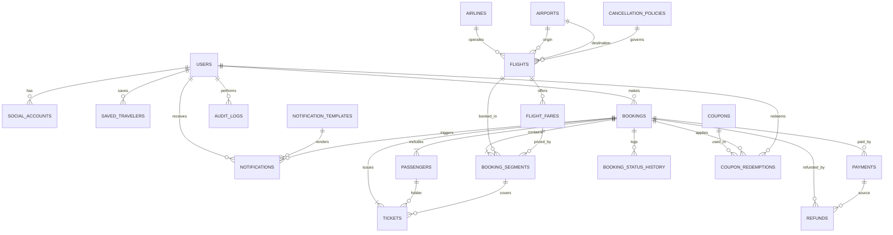

# Airline Ticket Booking System - SRS & ERD (MVP)

**System Requirements Specification (SRS) & Entity Relationship Diagram (ERD)**  
**Version:** 1.0 (MVP)  
**Project:** Flight Ticket Booking Platform (Inspired by Trip.com)  
**Date:** October 29, 2026  

---

## 1. Introduction

### 1.1 Goal
Build a web application that enables individuals to search for direct flights (one-way or round-trip), book them, pay for them, and receive their tickets via WhatsApp. Flights are manually entered through an Admin Panel.

### 1.2 Important Note
The website is a demo/MVP and is not connected to real airlines; therefore, issued tickets have no real travel value. A clear disclaimer must be displayed on the website and in the Terms of Service. Integration with a real GDS/Aggregator provider (e.g., Duffel or Amadeus) is postponed to a later phase.

### 1.3 Summary of Approved Decisions
* **Target Audience:** B2C Individuals.
* **Flight Source:** Manual entry via the Admin Panel.
* **Monetization:** Fixed service fee (adjustable from settings).
* **Flight Types:** Direct flights only; one-way or round-trip; international and domestic.
* **Services:** Flights only; all cabin classes (Economy, Premium Economy, Business, First).
* **Passengers:** Adult (12+ years), Child (2–11 years), Infant (under 2 years).
* **Registration:** Mandatory (no guest checkout). Login methods: Email, Mobile (OTP), Google, Facebook.
* **Payment Methods:** Cards and e-wallets via Stripe, Bank Transfer, and Cash Payment at office.
* **Currency:** US Dollar (USD) only.
* **Price Hold Duration:** 48 hours.
* **Ticket Delivery:** WhatsApp (with downloadable PDF copy in user account).
* **Languages:** Arabic and English with full RTL support.
* **Tech Stack:** Laravel (API) + React + MySQL (Web application only).
* **Expected Scale:** ~10 bookings daily in Year 1.

---

## 2. Roles & Permissions

* **Customer:** Searches, books, pays, manages their bookings and saved travelers.
* **Support Staff:** Handles cancellation and amendment requests, approves manual payment bookings.
* **Accountant:** Views payments, refunds, and financial reports.
* **Admin:** Full permissions (Flights, Fares, Fees, Users, Coupons, Content, Reports, Audit Logs).

---

## 3. Functional Requirements

### 3.1 Authentication & User Accounts (AUTH)
* **AUTH-1:** Registration and login via email and password with email verification.
* **AUTH-2:** Registration and login via mobile number using One-Time Password (OTP).
* **AUTH-3:** Social login via Google and Facebook.
* **AUTH-4:** Password recovery, profile editing, and preferred language setting.
* **AUTH-5:** Save frequent traveler details (First/Last name as in passport, DOB, passport number, passport expiry date, nationality).
* **AUTH-6:** Prevent booking prior to login. Search results are preserved, and user is prompted to log in upon clicking "Book".

### 3.2 Flight Search (SRCH)
* **SRCH-1:** Search inputs: From, To (autocomplete airport search), Departure Date, Return Date (optional), Passenger counts (Adults, Children, Infants), Cabin Class.
* **SRCH-2:** Display available direct flights with sufficient seat capacity for the requested class.
* **SRCH-3:** Filters & Sorting: Price, departure time, duration, airline. Default sort: Lowest Price.
* **SRCH-4:** Simple price calendar showing fare variations for dates close to the selected date.
* **SRCH-5:** For round-trip searches, the user selects an outbound flight then a return flight, displaying the combined total price.

### 3.3 Booking (BOOK)
* **BOOK-1:** Constraints: Maximum 9 passengers; infant count cannot exceed adult count; infants do not occupy a seat.
* **BOOK-2:** Input passenger details alongside primary contact email and phone number.
* **BOOK-3:** Display price summary breakdown: Base price per age group + Service Fee - Discounts = Total (USD).
* **BOOK-4:** Upon booking confirmation, seats are reserved (deducted from availability), a 6-character reference code (PNR) is generated, and a 48-hour price hold timer begins.
* **BOOK-5:** Unpaid bookings automatically expire via a Scheduled Job after 48 hours, returning seats to inventory.
* **BOOK-6:** Booking Statuses: `PENDING_PAYMENT`, `AWAITING_APPROVAL`, `CONFIRMED`, `TICKETED`, `CANCEL_REQUESTED`, `CANCELLED`, `REFUNDED`, `EXPIRED`.
* **BOOK-7:** Prevent double-booking on concurrent seat requests via database-level row locking (`SELECT ... FOR UPDATE`).

### 3.4 Payments (PAY)
* **PAY-1:** Online cards and e-wallets (Apple Pay, Google Pay) via Stripe Checkout. Card data is never stored on app servers.
* **PAY-2:** Payment verification via Stripe Webhooks with signature validation and idempotency handling.
* **PAY-3:** Bank Transfer: System displays account details and reference code; customer uploads receipt; staff reviews and approves/rejects.
* **PAY-4:** Cash Payment at Office: Booking held under standard price hold timer; staff manually confirms payment receipt.
* **PAY-5:** Manual Approval Flow: Bank transfer and cash payments enter `AWAITING_APPROVAL` status and tickets are not issued until staff/accountant approval.
* **PAY-6:** All monetary transactions occur strictly in USD; no currency conversion handling.

### 3.5 Coupons & Discounts (CPN)
* **CPN-1:** Admin coupon creation: Code, Type (Percentage or Fixed Amount), Value, Max Discount, Min Order Amount, Start/End dates, Total Usage Limit, Per-user Usage Limit.
* **CPN-2:** Real-time coupon application and verification on checkout page.
* **CPN-3:** Discount applies exclusively to base flight fares, not to service fees.
* **CPN-4:** Loyalty points program is deferred post-MVP.

### 3.6 Tickets & Notifications (NTF)
* **NTF-1:** Upon confirmation, system generates a PDF ticket with a QR/Barcode containing passenger/flight details, sent via WhatsApp Business API and available for download in user account.
* **NTF-2:** Multi-channel notifications (Email, WhatsApp, In-App) for: Booking confirmation, Payment reminders (24h and 6h prior to expiry), Payment success, Ticket issuance, Flight change/cancellation by admin, Payment rejection, Pre-travel reminder (24h), Cancellation & Refund confirmation.
* **NTF-3:** Notification templates editable via admin panel in both Arabic and English.
* **NTF-4:** Asynchronous notification execution via background Queues with retry mechanism and audit delivery logs.

### 3.7 Cancellations, Modifications & Refunds (CAN)
* **CAN-1:** Semi-automated workflow: Customer submits request from account (`CANCEL_REQUESTED`), processed manually by support staff.
* **CAN-2:** System calculates suggested refund based on flight cancellation policy (e.g., >72h prior: 90% refund; 24h–72h: 50%; <24h: No refund). Service fees are non-refundable. Rates customizable per flight.
* **CAN-3:** Staff reviews and confirms/adjusts amount. Refunds processed via Stripe API for card payments, or manually for bank transfers/cash.
* **CAN-4:** Date/Name Changes: Handled as cancellation + new booking for MVP. Typo corrections in names can be manually fixed by support staff.
* **CAN-5:** Flight cancellation initiated by admin notifies affected passengers and offers 100% full refund.

### 3.8 Admin Panel (ADM)
* **ADM-1:** Flight Management: Airlines, Airports, Flights (route, schedules, status), Fares & Seat allocations per class and age category, Baggage policies, Cancellation policies, Bulk CSV import.
* **ADM-2:** Booking Management: Search/Filter, View details, Status override, Manual payment approval, Resend ticket.
* **ADM-3:** User & Role Management: Support, Accountant, Admin roles, Account suspension.
* **ADM-4:** Pricing & Fee Settings: Fixed service fee value, child/infant price ratios, hold time duration.
* **ADM-5:** Coupons & Content Management: Banners, Pages (About Us, Terms, Privacy, FAQ) in Arabic & English.
* **ADM-6:** Audit Logs: Complete history tracking for fare changes, manual booking updates, and payments.

### 3.9 Reporting (RPT)
* **RPT-1:** Sales Reports: Daily / Weekly / Monthly metrics for booking count and gross value.
* **RPT-2:** Revenue Reports: Net service fee earnings minus Stripe fees and coupon discounts.
* **RPT-3:** Analytics: Most requested destinations, routes, and airlines.
* **RPT-4:** Payment Status Breakdown: Successful, Pending, Failed, Refunded, Expired.
* **RPT-5:** Data Export: All reports exportable to Excel/CSV format.

---

## 4. Non-Functional Requirements

* **Performance:** Search results returned in < 2 seconds for 95% of requests. Concurrent load capacity of 100 users.
* **Security:** HTTPS encryption mandatory. Passport data encrypted at field level (`AES-256`) in database. Passwords hashed using `bcrypt`/`Argon2`. Protection against OWASP Top 10 (SQLi, XSS, CSRF). Rate limiting on Auth & OTP endpoints. Daily automated database backups.
* **Compliance:** PCI DSS compliance maintained via Stripe Hosted Checkout (no cardholder data stored on local servers). GDPR/Privacy compliant: Explicit consent for passport data processing, account deletion capability, automated deletion of passport data X days post-flight.
* **Localization:** Full Arabic and English support (i18n), RTL layout support, localized date/time formats.
* **Compatibility:** Cross-browser support for Chrome, Firefox, Safari, Edge. Mobile-responsive layout.
* **Reliability:** Target 99.9% uptime. Centralized error tracking and logging via Sentry.
* **Scalability:** Decoupled RESTful API design. Data access layer adapter pattern for flight providers to facilitate seamless future GDS API integration.
* **Testing:** Unit and integration testing covering fare calculation logic, seat inventory locking, hold expiration jobs, and refund formulas.

---

## 5. Main User Stories & Acceptance Criteria

1. **US-1 (Search):** As a customer, I want to search for round-trip flights so that I can see available options and total costs.  
   *Acceptance Criteria:* Displays available direct flights matching seat criteria with cumulative total price for all selected passengers.
2. **US-2 (Card Booking):** As a customer, I want to pay via credit card so that my ticket is issued instantly.  
   *Acceptance Criteria:* Upon successful Stripe transaction, booking status transitions to `TICKETED` within 1 minute and PDF ticket is delivered via WhatsApp.
3. **US-3 (Bank Transfer):** As a customer, I want to upload a bank transfer receipt.  
   *Acceptance Criteria:* Status sets to `AWAITING_APPROVAL` until support staff verifies and approves payment.
4. **US-4 (Coupons):** As a customer, I want to apply a discount coupon at checkout.  
   *Acceptance Criteria:* Valid discount reduces total fare instantly without exceeding max discount cap. Expired/invalid codes are rejected with clear error messages.
5. **US-5 (Admin Flight Entry):** As an admin, I want to add flights with multi-class seating.  
   *Acceptance Criteria:* Newly created flights immediately reflect in search queries with exact seat inventories and price rules.
6. **US-6 (Reports):** As an admin/accountant, I want to view revenue reports.  
   *Acceptance Criteria:* Report figures match payment logs and support CSV export.
7. **US-7 (Hold Expiry):** As a system, I must cancel unpaid bookings after 48 hours.  
   *Acceptance Criteria:* Reserved seats return to inventory pool and expiration notification is dispatched to user.

---

## 6. Out of Scope (Post-MVP)

* Multi-city and multi-stop flight itineraries.
* Hotel bookings, car rentals, or travel insurance add-ons.
* Interactive seat selection maps and extra baggage add-on purchases.
* Multi-currency support and real-time exchange rates.
* Guest checkout flow.
* Native iOS/Android mobile apps.
* Direct GDS/Aggregator API integrations (Amadeus, Sabra, Duffel).
* Fully automated cancellation and ticket re-issuance workflows.
* B2B Travel Agent portal and commission systems.

---

## 7. Timeline & Estimated Budget

Building this complete scope (4 authentication methods, online payments, WhatsApp integration, admin portal, dual-language RTL) requires a multi-week structured effort.

* **Clickable Prototype (2 Days):** Basic interactive UI mockups for search, results, and booking pages alongside a rudimentary flight input panel. Ideal for demoing to stakeholders.
* **Phase 1 (2–3 Weeks):** User Accounts, Search Engine, Booking Engine, Hold Timer Logic, Stripe Integration, Core Admin Panel.
* **Phase 2 (2 Weeks):** WhatsApp & Email Notification Queues, Coupon System, Bank Transfer & Cash Workflows with Approval Queues, Cancellation/Refund Engine.
* **Phase 3 (1–2 Weeks):** Financial Reporting, Multilingual & RTL Polish, Security Hardening, End-to-End Testing & Production Launch.
* **Total Duration:** 6–8 Weeks for a core team (2 Developers + 1 Part-time UI/UX Designer).
* **Estimated Budget:** $8,000 – $18,000 (varies based on regional development rates). Operational costs: Hosting ($20–$60/mo), WhatsApp API fees (per message tier), Stripe transaction fees (~2.9% + $0.30 per transaction).

---

## 8. MVP Key Performance Indicators (KPIs)

* **Booking Efficiency:** Complete end-to-end user booking flow (Search -> Book -> Pay -> Receive Ticket) completed in < 5 minutes.
* **Payment Success Rate:** > 95% successful online payments; > 98% successful ticket delivery rate.
* **Inventory Integrity:** Zero double-booking incidents.
* **System Stability:** Sub-2 second API response times and zero critical vulnerabilities during month 1.
* **Operational Autonomy:** Platform capable of handling 10+ daily bookings without requiring manual technical intervention.

---

## 9. Entity Relationship Diagram (ERD)

### 9.1 Primary Entities & Attributes

* **`users`:** `id`, `name`, `email`, `phone`, `password_hash`, `role` (`customer` | `support` | `accountant` | `admin`), `locale`, `email_verified_at`, `phone_verified_at`, `status`.
* **`social_accounts`:** `id`, `user_id`, `provider` (`google` | `facebook`), `provider_user_id`.
* **`saved_travelers`:** `id`, `user_id`, `first_name`, `last_name`, `gender`, `birth_date`, `nationality`, `passport_no` (Encrypted), `passport_expiry`, `passenger_type`.
* **`airlines`:** `id`, `code` (IATA), `name_ar`, `name_en`, `logo`.
* **`airports`:** `id`, `iata_code`, `name_ar`, `name_en`, `city_ar`, `city_en`, `country_code`, `timezone`.
* **`cancellation_policies`:** `id`, `name`, `rules` (JSON storing hours and refund percentages).
* **`flights`:** `id`, `airline_id`, `flight_number`, `origin_airport_id`, `destination_airport_id`, `departure_at`, `arrival_at`, `aircraft`, `status` (`scheduled` | `delayed` | `cancelled`), `cancellation_policy_id`.
* **`flight_fares`:** `id`, `flight_id`, `cabin_class` (`economy` | `premium_economy` | `business` | `first`), `adult_price`, `child_price`, `infant_price`, `seats_total`, `seats_available`, `baggage_kg`, `cabin_baggage_kg`.
* **`bookings`:** `id`, `pnr`, `user_id`, `trip_type` (`one_way` | `round_trip`), `contact_email`, `contact_phone`, `subtotal`, `service_fee`, `discount_total`, `total`, `currency` (`USD`), `status`, `hold_expires_at`, `coupon_id`, `approved_by`, `created_at`.
* **`booking_segments`:** `id`, `booking_id`, `flight_id`, `flight_fare_id`, `direction` (`outbound` | `return`), `fare_snapshot` (JSON).
* **`passengers`:** `id`, `booking_id`, `first_name`, `last_name`, `gender`, `birth_date`, `nationality`, `passport_no` (Encrypted), `passport_expiry`, `passenger_type` (`adult` | `child` | `infant`).
* **`tickets`:** `id`, `booking_id`, `passenger_id`, `segment_id`, `ticket_number`, `pdf_path`, `issued_at`, `status`.
* **`payments`:** `id`, `booking_id`, `method` (`card` | `wallet` | `bank_transfer` | `cash`), `provider` (`stripe` | `manual`), `provider_ref`, `amount`, `currency`, `status`, `receipt_path`, `reviewed_by`, `paid_at`.
* **`refunds`:** `id`, `booking_id`, `payment_id`, `amount`, `reason`, `status`, `requested_at`, `processed_by`, `processed_at`.
* **`coupons`:** `id`, `code`, `type` (`percent` | `fixed`), `value`, `max_discount`, `min_order`, `starts_at`, `ends_at`, `usage_limit`, `per_user_limit`, `is_active`.
* **`coupon_redemptions`:** `id`, `coupon_id`, `user_id`, `booking_id`, `discount_amount`.
* **`booking_status_history`:** `id`, `booking_id`, `from_status`, `to_status`, `changed_by`, `note`, `created_at`.
* **`notification_templates`:** `id`, `event_key`, `channel` (`email` | `whatsapp` | `in_app`), `locale`, `subject`, `body`.
* **`notifications`:** `id`, `user_id`, `booking_id`, `template_id`, `channel`, `status` (`queued` | `sent` | `failed`), `sent_at`, `error`.
* **`settings`:** `key`, `value` (Service fee, hold duration, infant/child ratios, bank details).
* **`content_pages` / `banners`:** `id`, `slug`, `title_ar`, `title_en`, `body_ar`, `body_en`, `is_published`.
* **`audit_logs`:** `id`, `user_id`, `action`, `entity_type`, `entity_id`, `old_values`, `new_values`, `ip`, `created_at`.

### 9.2 Mermaid ER Diagram

### 9.3 Critical Design Rules
1. **Price Snapshot (`fare_snapshot`):** Store complete fare calculations in `booking_segments` at the moment of booking so future price updates do not retroactively alter existing records.
2. **Seat Inventory Lock:** Inventory decrements on `flight_fares.seats_available` must occur within an isolated database Transaction using pessimistic row locking (`SELECT ... FOR UPDATE`). No seat deductions for infant passengers.
3. **Database Indexing:** Ensure indexes exist on `(origin, destination, departure_at)` for flights, and `(pnr, status, hold_expires_at)` for bookings.
4. **Soft Deletes:** Implement soft deletion on flight and booking models. Financial and transaction records must never be hard-deleted.
5. **Data Encryption:** `passport_no` fields in `passengers` and `saved_travelers` must use application-level encryption (`AES-256`).

---

## 10. Implementation Decisions to Confirm

1. **Manual Approvals:** The phrase "Approval on Purchase" has been interpreted as requiring manual support/accountant review for bank transfers and cash payments prior to ticket issuance. Online card payments auto-issue tickets.
2. **Service Fee Structure:** Configured as a flat fixed fee per booking transaction (e.g., $10).
3. **Date/Name Modifications:** Handled via cancellation + new booking workflow, with manual support override for minor name spelling corrections.
4. **WhatsApp Business API:** Meta requires an approved business account and pre-approved message templates (approval process usually takes several days).